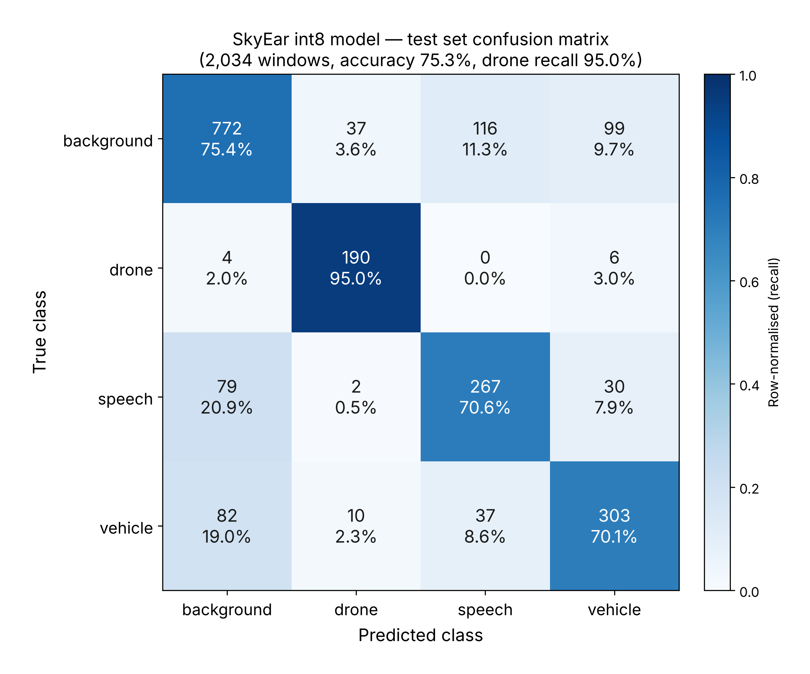

# SkyEar: Acoustic Drone Detection Node

Edge Computing & Intelligent Systems project. An ESP32-S3 node listens through an INMP441 microphone, classifies 1 s audio windows on-device with an int8 DS-CNN, and sends only classified events and telemetry over **ESP-NOW**, Espressif's direct board-to-board protocol on the built-in 2.4 GHz radio. An ESP32 gateway raises the alarm locally (siren, buzzer, OLED) and logs to ThingSpeak. The alarm path never depends on the internet.

```
INMP441 ─I2S─▶ ESP32-S3 node ──ESP-NOW 2.4 GHz──▶ ESP32 gateway ──Wi-Fi HTTPS──▶ ThingSpeak
 16 kHz        log-mel 49x40                       relay + 12 V siren             8 fields + status
               int8 DS-CNN                         buzzer, OLED, LEDs             React email alerts
               3-of-4 hysteresis                   ACK button, 60 s cut-off
```

**Why ESP-NOW instead of LoRa:** the original design used SX1278 LoRa modules at 433 MHz. They were not available, so the link uses the radio already inside both ESP32s. The packet format, detection rules and alarm logic are unchanged. The trade-off is range: tens of metres indoors and roughly 100–200 m line of sight, against LoRa's kilometre class. That is enough for the bench demo and one yard sector, but not for a long perimeter.

## Repository

| Path | What it is |
|---|---|
| `common/skyear_packet.h` | 19-byte radio packet with CRC-8, shared by both boards |
| `node/` | Sensor node firmware (PlatformIO, ESP32-S3-DevKitC-1 N16R8) |
| `node/src/logmel.*` | Log-mel front end, identical to `training/features.py` |
| `node/src/model_data.h` | Placeholder; `training/train.py` replaces it with the trained model |
| `gateway/` | Gateway firmware (PlatformIO, ESP32 DevKit V1) |
| `training/` | Feature extraction, DS-CNN training, int8 quantisation, C-header export |
| `tools/record_serial.py` | Records training audio from the node's own microphone |
| `tools/check_logmel.py` | Checks the C++ and Python feature extractors match |

## Verification status

Done without hardware:

| Check | Result |
|---|---|
| Node firmware compiles and links (Arduino-ESP32 2.0.17, ESP32-S3) | 730 KB program, 181 KB static RAM; 1.0 MB with a model |
| Gateway firmware compiles and links (ESP32) | 942 KB program, 57 KB static RAM |
| C++ log-mel vs Python log-mel | Max difference 1.6e-4 |
| Training pipeline end to end (train, int8 quantise, export header) | Runs; ~23.8k parameters, ~48 KB int8 model |
| Node's TFLite Micro library runs the exported model (host build) | Matches TensorFlow within 1 int8 step; 71.7 KB arena of 100 KB |

Needs the hardware:

- Inference time per window on the ESP32-S3 (printed on serial as `inf=...us`)
- Real accuracy and false-alarm rate (needs real recordings; see Training)
- ESP-NOW range, siren and relay behaviour, ThingSpeak writes

## Wiring

**Sensor node (ESP32-S3-DevKitC-1 N16R8)**

| Part | Pins |
|---|---|
| INMP441 | SCK→GPIO4, WS→GPIO5, SD→GPIO6, L/R→GND, VDD→3V3 |
| BME280 (0x76), optional | SDA→GPIO8, SCL→GPIO9, 3V3 |
| Battery sense, optional | 2 × 100 kΩ divider from cell + to GND, midpoint → GPIO1; set `BATTERY_SENSE_ENABLED 1` |
| Power | USB for the demo; or 18650 → TP4056 (protected) → 3.3 V buck-boost → 3V3, common GND |

**Gateway, minimal build (default, `EXTERNAL_ALARM_PARTS 0`)**: only the OLED is wired

| Part | Pins |
|---|---|
| SSD1306 OLED (0x3C) | VCC→3V3, GND→GND, SCL→GPIO22, SDA→GPIO21 |
| Alarm light | on-board blue LED (GPIO2): fast blink = alarm, slow blink = node offline |
| ACK button | on-board BOOT button (GPIO0); press only after the board has booted |

In this build the "siren" is the flashing OLED plus the blue LED. Some DevKit boards have no user LED on GPIO2; the OLED alone still shows every state.

**Gateway, full build (`EXTERNAL_ALARM_PARTS 1` in `gateway/src/config.h`)**

| Part | Pins |
|---|---|
| SSD1306 OLED (0x3C) | SDA→GPIO21, SCL→GPIO22, 3V3 |
| Relay module | IN→GPIO27, VCC→VIN (5 V); siren on the NO contact with its own fused 12 V supply |
| Buzzer | GPIO25 → 1 kΩ → 2N2222 base; buzzer between 3V3 and collector |
| LEDs | Green GPIO4, amber GPIO13, 330 Ω each |
| ACK button | GPIO32 to GND (internal pull-up) |

No radio wiring is needed: ESP-NOW uses each board's built-in antenna (the zig-zag trace at the end of the module). Keep that end clear of metal and of your hand.

## Quick start

```bash
pip install platformio
# 1. Gateway
cp gateway/src/secrets.example.h gateway/src/secrets.h   # add Wi-Fi + ThingSpeak keys
cd gateway && pio run -t upload && pio device monitor
# 2. Node: first set ROUTER_SSID in node/src/config.h to the same Wi-Fi name
cd ../node && pio run -t upload && pio device monitor
```

Both boards print the channel they chose (`ESP-NOW ready on channel 6`, `router found, channel 6`). **The two numbers must match.** The gateway OLED shows the node within 30 s, and ThingSpeak status reads `NO MODEL` until you flash a trained model.

**Why the channel matters:** ESP-NOW only works when both boards are on the same Wi-Fi channel, and the gateway has to sit on its router's channel to reach the internet. So the node looks up the router's channel by name at boot. If the router is off at boot, both boards fall back to channel 1. If you change routers or the router changes channel, reboot both boards.

## Training

1. **Get data.** One folder of WAV files per class in `training/data/`:
   - `drone/`: the `yes_drone` clips from the [DroneAudioDataset](https://github.com/saraalemadi/DroneAudioDataset), plus your own toy-drone recordings.
   - `background/`: the dataset's `unknown` clips, plus wind and room noise from your demo site.
   - `speech/` and `vehicle/`: your own recordings, or matching ESC-50 / Speech Commands clips.
2. **Record on the real mic** (strongly recommended). The model only holds up live if it has heard the INMP441:
   ```bash
   # set #define RECORD_MODE in node/src/config.h, flash, then:
   python tools/record_serial.py --port /dev/ttyACM0 --seconds 30 --out training/data/drone/quad_01.wav
   ```
   Undo `RECORD_MODE` afterwards.
3. **Train:**
   ```bash
   cd training && pip install -r requirements.txt
   python train.py --data data --out ../node/src/model_data.h
   ```
   This writes `results/metrics.json`: files per class, train/val/test windows, parameter count, model size, test accuracy, drone recall at 0.8, and false-alarm rate at 0.8. Use these numbers in your report, not estimates. The split is by recording, so windows from one file never land in both train and test.
4. **Flash the node** again and watch serial: each window prints class, P(drone), RMS level, feature time and inference time.

## Detection rules (node)

- A window votes "drone" when P(drone) ≥ 0.8. An ALERT is sent when 3 of the last 4 votes are drone, then repeated every 3 s while it holds (broadcasts are not acknowledged).
- A CLEAR is sent after 10 consecutive windows below 0.5 (5 s).
- Telemetry doubles as the heartbeat: every 30 s, or every 60 s below 3.4 V. Below 3.2 V the node sends a final packet and deep-sleeps, waking every 30 min. These battery rules are switched off while `BATTERY_SENSE_ENABLED` is 0.
- Packets are ESP-NOW broadcasts, so no pairing or MAC addresses are needed. Broadcasts are not acknowledged, which is why ALERTs repeat.

## Gateway rules

- On ALERT, the relay closes, the buzzer beeps for 1.6 s, the OLED latches "DRONE NODE 1 xx%", and a cloud write is forced as soon as the 15 s ThingSpeak limit allows.
- The siren stops when ACK is pressed, or automatically after 60 s. The OLED stays latched until it has been acknowledged and the node has cleared.
- No packet for 90 s sets the amber LED and the NODE OFFLINE status.
- The relay is driven to off before its pin becomes an output, so a reboot never fires the siren. A hardware watchdog restarts either board if the firmware hangs.
- Cloud uploads run in their own task on the other CPU core, so a slow or failing HTTPS call cannot delay the alarm. While Wi-Fi is down, records queue (up to 200) and upload in one bulk call on reconnect, with their original timestamps.
- If the router goes down, the gateway stops its connection attempt after 8 s, parks the radio back on the node's channel, and retries every 30 s, so node packets keep arriving between attempts.

## ThingSpeak setup

Create a channel with 8 fields:

| Field | Value |
|---|---|
| 1 | Drone confidence (max in interval, 0–1) |
| 2 | Detection state (0/1) |
| 3 | Ambient sound level (dBFS) |
| 4 | Temperature (°C) |
| 5 | Humidity (%RH) |
| 6 | Node battery (V) |
| 7 | Link signal strength, RSSI (dBm) |
| 8 | Siren / relay state (0/1) |

Put the channel ID and Write API key in `secrets.h`. For email alerts, add **React** rules on Field 2 = 1, Field 8 = 1, and Status = `NODE OFFLINE`, each linked to a **ThingHTTP** or MATLAB Analysis email action.

## Known limits

- The node uses the community `TensorFlowLite_ESP32` library because the 2.0.x core does not bundle Espressif's TFLite Micro. It runs this model correctly but has no ESP-NN acceleration. Measure the inference time; it must stay well under the 500 ms hop.
- The gateway's HTTPS client skips certificate checks (`setInsecure`). Pin the ThingSpeak root CA before any real deployment.
- ESP-NOW range is far shorter than LoRa's, and a node that is always listening on Wi-Fi draws more current than a LoRa node, so battery life is shorter than the original design's estimate.
- Many relay boards switch on with a LOW input. Check `RELAY_ACTIVE` in `gateway/src/config.h` against your board before connecting the siren.


## Results

int8 model on the held-out test set (2,034 one-second windows):

| Metric | Value |
|---|---|
| Overall accuracy | 75.3% |
| Drone recall | 95.0% (190 / 200) |
| Drone precision | 79.5% |
| Model size | about 48 KB int8 |
| Inference on ESP32-S3 | about 1.46 s per window |



Rows are true classes, columns are predicted classes. Most errors are between background, speech and vehicle, which do not trigger the drone alarm. The alarm needs P(drone) >= 0.8 in 3 of 4 windows.
